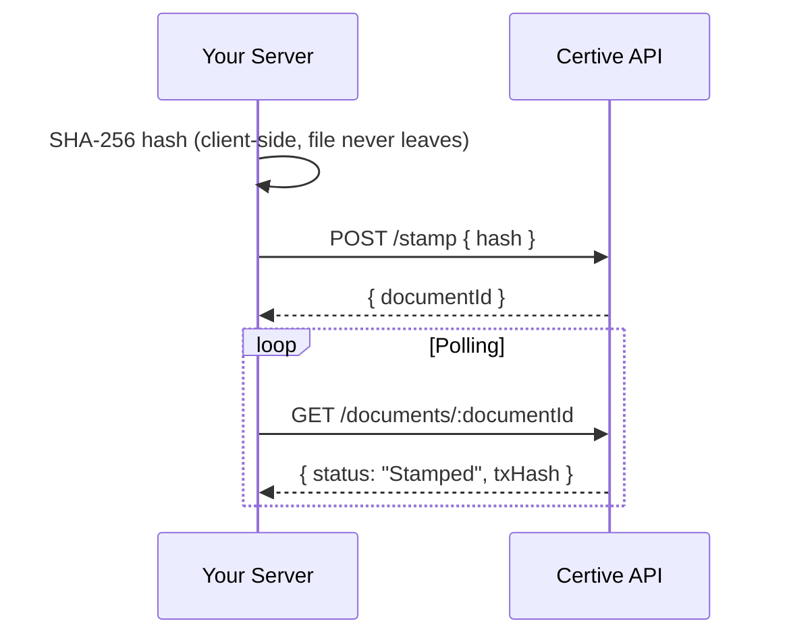

# Certive EDMS — Integration Examples

Code examples for integrating with the [Certive EDMS API](https://api.certive.id/docs).

These examples demonstrate how to:
1. Compute a SHA-256 hash of a file **client-side** (the file never leaves your server)
2. Stamp the document hash on the blockchain via the API
3. Poll for on-chain confirmation

> **Full API reference:** <https://api.certive.id/docs>

---

## How it works

Certive does not receive your files. Instead, you compute the SHA-256 hash of a file locally and submit only the hash. The hash is then anchored on-chain, creating a tamper-proof timestamp of the document's content.



## Authentication

All API requests require an API key passed as the `X-API-Key` header:

```
X-API-Key: ck_your_api_key_here
```

Generate an API key from your organization settings in the Certive dashboard.

---

## Examples

| Language | Single stamp | Batch stamp |
|---|---|---|
| [Node.js](./node/) | `node single_stamp.js <file>` | `node batch_stamp.js <file1> <file2> ...` |
| [Python](./python/) | `python single_stamp.py <file>` | `python batch_stamp.py <file1> <file2> ...` |
| [PHP](./php/) | `php single_stamp.php <file>` | `php batch_stamp.php <file1> <file2> ...` |
| [cURL](./curl/) | `bash single_stamp.sh <file>` | `bash batch_stamp.sh <file1> <file2> ...` |

See each folder's `README.md` for setup instructions.

---

## Error handling

All API errors follow this shape:

```json
{
  "message": "Human-readable message",
  "data": null,
  "error": { "code": "ERROR_CODE" }
}
```

Common error codes:

| Code | Meaning |
|---|---|
| `DOCUMENT_ALREADY_STAMPED` | This hash was already stamped — no action needed |
| `QUOTA_EXCEEDED` | Monthly document quota reached — upgrade your plan or purchase credits |
| `INSUFFICIENT_CREDITS` | Credit balance too low |
| `DUPLICATE_ITEMS` | Batch contains duplicate hashes |
